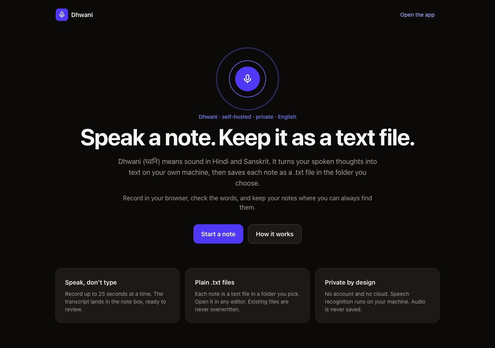
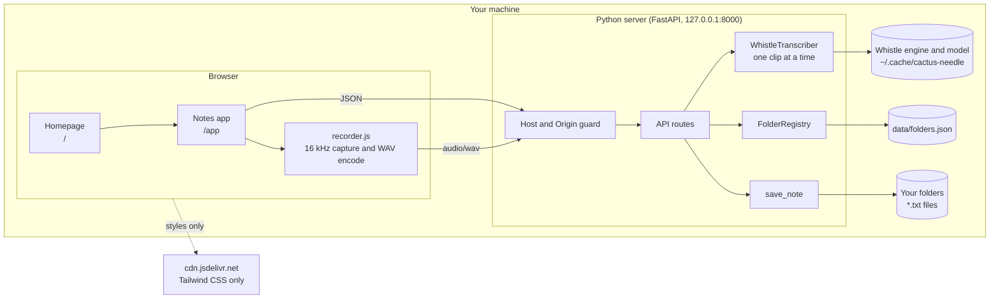
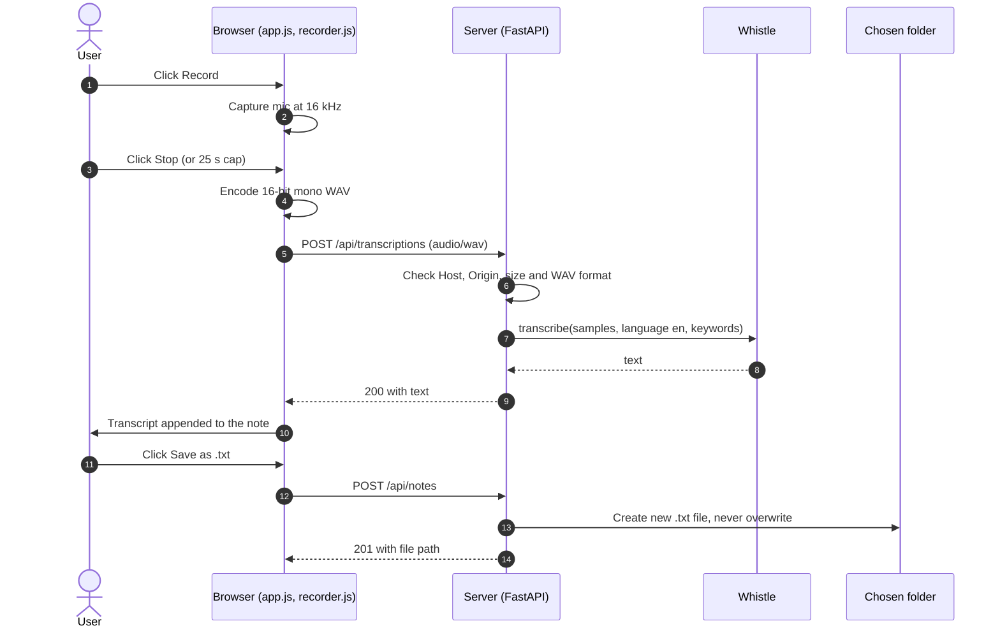
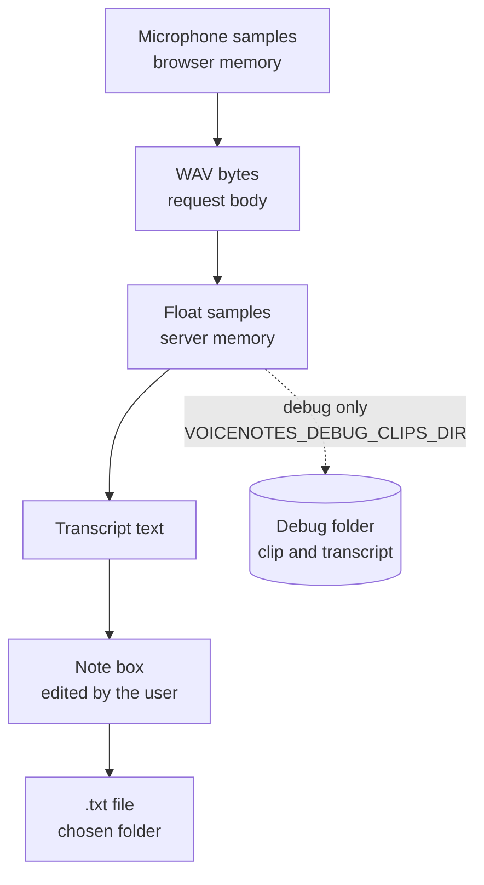
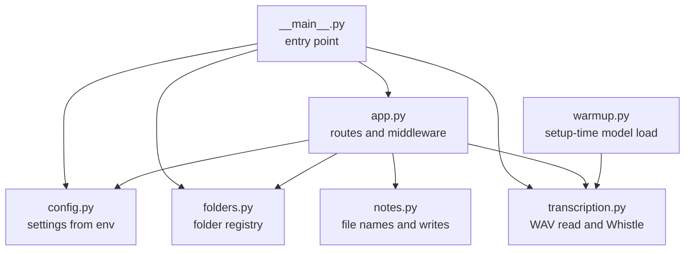

# Dhwani

Dhwani (ध्वनि) means sound in Hindi and Sanskrit. It is a self-hosted voice notes app. Speak a note in your browser. Dhwani turns it into text on your own machine and saves it as a `.txt` file in the folder you choose.

- **Private by design:** audio and note text never leave your machine. Speech recognition runs locally with [Whistle](https://huggingface.co/Cactus-Compute/whistle).
- **Plain files:** each note is a `.txt` file. No notes database, no lock-in.
- **Simple stack:** Python 3.12, FastAPI, vanilla JavaScript, Tailwind CSS.



**Tags:** `voice-notes` `speech-to-text` `note-taking` `self-hosted` `privacy` `offline` `local-first` `fastapi` `python` `tailwindcss` `whistle` `transcription`

## Contents

- [Architecture](#architecture)
- [First-time setup](#first-time-setup)
- [Run](#run)
- [Configuration](#configuration)
- [Model download](#model-download)
- [Save a note](#save-a-note)
- [Architecture decisions](#architecture-decisions)
- [Test](#test)
- [Known limits](#known-limits)

## Architecture

### Design principles

| Principle | What it means here |
|---|---|
| Local first | The server runs on the user's machine and binds to `127.0.0.1`. |
| Data stays local | Audio is transcribed in memory and discarded. Notes are plain files on disk. |
| Small surface | One FastAPI app, one speech model, one file-based store. |
| Explicit trade-offs | Each choice has an ADR with its context, consequences and a revisit trigger. |
| Testable seams | The transcriber and the folder registry are injected. Tests use fakes. |

### System context



Everything inside "Your machine" stays local. The only outside request is the Tailwind stylesheet. See [ADR-006](adr/ADR-006-frontend-tailwind-and-routes.md).

### Record and save sequence



### Audio lifecycle

Audio lives in memory only. Debug mode is the one exception, and it is off by default.



### Module layout



| Path | Purpose |
|---|---|
| `voicenotes/app.py` | Routes, request guard, error mapping |
| `voicenotes/transcription.py` | WAV parsing, Whistle wrapper, privacy environment settings |
| `voicenotes/folders.py` | Registered folders, stored in one JSON file |
| `voicenotes/notes.py` | Safe file names and no-overwrite writes |
| `voicenotes/config.py` | Environment settings |
| `voicenotes/static/` | `home.html`, `app.html`, `app.js`, `recorder.js`, `recorder-worklet.js` |
| `scripts/setup.sh` | First-time setup |
| `adr/` | Architecture decision records |

### API

| Method | Path | Purpose |
|---|---|---|
| GET | `/` | Homepage |
| GET | `/app` | Notes app |
| GET | `/healthz` | Health check |
| GET | `/api/folders` | List registered folders |
| POST | `/api/folders` | Register a folder by absolute path |
| DELETE | `/api/folders/{id}` | Unregister a folder. Files stay on disk. |
| POST | `/api/transcriptions` | Send one WAV clip, get text back |
| POST | `/api/notes` | Save a note as a `.txt` file |

### Trade-offs and scaling

- **One user, one process.** Whistle runs on the CPU, one clip at a time. This is the first bottleneck. The next step would be a worker pool, then a job queue.
- **Files, not a database.** Simple and portable. Search across folders would need an index. See [ADR-002](adr/ADR-002-save-notes-as-txt-files.md).
- **Clips, not streams.** Text appears after each clip. Live text needs streaming. See [ADR-004](adr/ADR-004-clip-limits-without-splitting.md).
- **Local-only access.** No login. Only local `Host` and `Origin` headers are accepted. See [ADR-008](adr/ADR-008-local-request-guard.md).

## First-time setup

After you clone the repo, run the setup script once from the project root:

```bash
./scripts/setup.sh
```

The script:

1. Installs the Python dependencies with `uv sync`.
2. Runs the test suite.
3. Downloads the Whistle engine and model. This needs network access once. Later runs reuse the cache.

Setup needs [uv](https://docs.astral.sh/uv/). macOS and Linux work. On Windows, use WSL. You can run the script again at any time.

## Run

```bash
uv run python -m voicenotes
```

Open http://127.0.0.1:8000 in your browser. The homepage is `/`. The notes app is `/app`.

The pages load Tailwind CSS from `cdn.jsdelivr.net`, so the styling needs internet access. Notes and audio stay on your machine. See [ADR-006](adr/ADR-006-frontend-tailwind-and-routes.md).

## Configuration

| Name | Default | Description |
|---|---|---|
| `VOICENOTES_HOST` | `127.0.0.1` | Address to listen on. Keep the default. The app has no login. |
| `VOICENOTES_PORT` | `8000` | Port. |
| `VOICENOTES_FOLDERS_PATH` | `data/folders.json` | File that stores the folder list. |
| `VOICENOTES_KEYWORDS` | empty | Comma-separated names to favor in speech, for example `Priya,Tom`. Helps some names, not all. |
| `VOICENOTES_DEBUG_CLIPS_DIR` | empty | Debug only. Saves each clip and its transcript to this folder. Leave empty for normal use. See [ADR-005](adr/ADR-005-debug-clip-retention.md). |

## Model download

`./scripts/setup.sh` downloads the Whistle engine and model from Hugging Face into `~/.cache/cactus-needle/`. Setup sets `HF_HUB_OFFLINE=0` for that one step. If you skip setup, run the warm-up step by hand before the first use:

```bash
HF_HUB_OFFLINE=0 uv run python -m voicenotes.warmup
```

After that, the app runs with no network access for speech recognition. The app also turns off the Whistle usage events (`NEEDLE_TELEMETRY=0`, `DO_NOT_TRACK=1`). See [ADR-007](adr/ADR-007-whistle-runtime-settings.md).

## Save a note

1. Add a folder by its absolute path, for example `/Users/you/Documents/Notes`.
2. Click **Record**, speak, then click **Stop**. The clip stops by itself after 25 seconds. The transcript is added to the note. You can also type.
3. Review the text. Pick the folder and click **Save as .txt**.

The title becomes the file name. A name that already exists gets ` (2)`, ` (3)` and so on. Files are never overwritten.

Removing a folder from the list does not delete its files.

Audio is not saved by default. The browser sends one clip, the server transcribes it, and the clip is discarded. Debug mode is the exception.

## Architecture decisions

| ADR | Decision |
|---|---|
| [ADR-001](adr/ADR-001-voice-note-app-plan.md) | Project plan. Whistle on the server, FastAPI, self-hosted, no outbound network for speech. |
| [ADR-002](adr/ADR-002-save-notes-as-txt-files.md) | Notes are `.txt` files in user-chosen folders. No notes database. |
| [ADR-003](adr/ADR-003-capture-audio-at-16khz-in-browser.md) | Capture audio at 16 kHz in the browser. |
| [ADR-004](adr/ADR-004-clip-limits-without-splitting.md) | 25 s browser cap, 30 s server limit, no automatic splitting. |
| [ADR-005](adr/ADR-005-debug-clip-retention.md) | Audio kept only in opt-in debug mode. |
| [ADR-006](adr/ADR-006-frontend-tailwind-and-routes.md) | Tailwind CSS from CDN. Homepage at `/`, app at `/app`. |
| [ADR-007](adr/ADR-007-whistle-runtime-settings.md) | Whistle telemetry off, offline by default, English only, keyword biasing. |
| [ADR-008](adr/ADR-008-local-request-guard.md) | Only local `Host` and `Origin` headers accepted. |

## Test

```bash
uv run pytest
```

The suite covers folder rules, file names and writes, the API, and WAV parsing. It uses a fake transcriber. The real Whistle path was checked by hand.

## Known limits

- English only.
- No login. Only `127.0.0.1` or `localhost` requests are accepted.
- Recordings stop at 25 seconds. Longer notes need several recordings.
- Whistle sometimes misses names, even with `VOICENOTES_KEYWORDS`. Edit those words by hand.
- A file write is not atomic. A crash in the middle can leave a partial file.
- No search across folders.
- The styling needs the Tailwind CDN. Without it, pages load unstyled.
