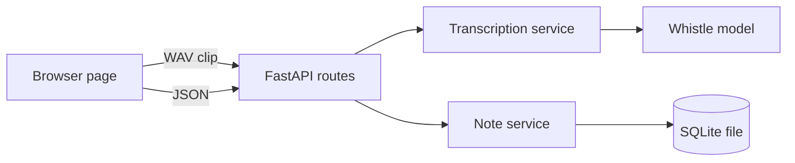

# ADR-001: Voice note app plan

Date: 2026-10-24
Status: Accepted. Amended by ADR-003 to ADR-008. Spike done. Decisions 2, 5 and 6 are amended, and Decision 7 has a CDN exception.

## Context

Users want to capture spoken thoughts as text notes in a browser. Privacy is the main driver. The app is self-hosted on the user's own machine, not deployed to a server. Whistle runs only in Python, CLI and C, so the local server must run it. Scope: English only, prototype (phases 1 and 2), with later phases outlined. See sections 1 and 2.

## Decision

Build a FastAPI server, run on the user's machine, that runs Whistle and stores transcripts in SQLite. Build a plain HTML, CSS and JavaScript frontend that records and uploads clips. The app makes no outbound network calls at runtime. Decisions 1 to 7 in section 3 give the reasons.

## Consequences

- Good: Works in any modern browser. Small stack. Easy to test. Audio and text never leave the user's machine.
- Bad: The user installs and runs the server. Text appears only after each clip. Single user, single process. Notes exist only on that machine.
- Revisit trigger: Whistle ships a browser build, or the app needs more than one user or machine.

## Details

## Purpose

The app turns a spoken note into text. The user speaks in a web browser. The app sends the audio to a local server. The server uses Whistle to make a transcript and saves it as a note. The user reads, edits and deletes notes in the same browser page.

Whistle runs only in Python, the command line and C. It has no browser build. So the local server runs Whistle, not the browser. Everything runs on the user's own machine. No cloud service receives the audio or the text.

## Terms

| Term | Meaning in this project |
|---|---|
| Whistle | The speech-to-text model from Cactus Compute. The app uses its Python package. |
| Clip | One audio recording of at most 30 seconds. The browser sends one clip at a time. |
| Transcript | The text that Whistle returns for one clip. |
| Note | A saved record with a title, a body and timestamps. |
| Backend | The Python server. It runs Whistle and stores notes. |
| Frontend | The HTML, CSS and JavaScript page that the browser loads. |
| Real-time factor | Processing time divided by clip length. A value below 1.0 means the server is faster than the audio. |

## 1. Problem and done

Users want to capture a thought by voice, without typing. The riskiest part is whether Whistle gives readable text on the user's speech, fast enough on this machine.

Definition of done for the prototype: the user speaks a note of about 20 seconds on `localhost`. The page shows the transcript. The user edits it. The note stays in the list after a page reload.

Definition of done for production: not in scope yet. See section 9.

## 2. Assumptions, ordered by risk

| # | Assumption | How to check | Status |
|---|---|---|---|
| A1 | Whistle transcribes the user's speech well enough. | Phase 1 spike, three real clips. | Open |
| A2 | Whistle processes a clip faster than its length on this Mac. | Phase 1 spike, measure real-time factor. | Open |
| A3 | Whistle installs with Python 3.12, as set in `.python-version`. | Phase 1 install. | Open |
| A4 | The Whistle package name is `needle`, as in `pyproject.toml`. | Check the package index. The model page says `pip install cactus-needle`. | Open, conflict found |
| A5 | Whistle needs the server. No browser build exists. | Model page lists Python, CLI and C API only. | Checked |
| A6 | The browser can record and send 16 kHz mono audio. | Test in Chrome and Safari on `localhost`. | Open |
| A7 | Transcription works with no network access. | Phase 1 spike, with outbound traffic blocked. | Open |

## 3. Decisions

### Decision 1: Run Whistle on the server

- Context: Whistle has no browser or WebAssembly build, according to its model page.
- Decision: A Python backend loads Whistle once and runs every transcription.
- Good: Works in any modern browser. The model loads once, not per page.
- Bad: Audio travels to the local server. The local CPU does all the work.
- Revisit trigger: Whistle publishes a browser build.

### Decision 2: Plain HTML, CSS and JavaScript frontend (amended by ADR-006: Tailwind CSS from CDN, separate homepage and app pages)

- Context: The app has one page and few states. The user asked for these tools.
- Decision: No framework and no build step. Files are served as they are.
- Good: No toolchain to maintain. The code is easy to read.
- Bad: The page code manages the DOM by hand. More screens make this harder.
- Revisit trigger: More than five screens, or shared state that is hard to follow.

### Decision 3: FastAPI for the backend

- Context: The server needs JSON routes, file upload and a health endpoint.
- Decision: FastAPI with uvicorn. Verify the current versions at install time.
- Good: Typed request checks. Automatic API docs. WebSocket support for phase 3.
- Bad: Two more dependencies. Alternatives are the standard `http.server` (no validation) and Flask (no async).
- Revisit trigger: None expected.

### Decision 4: SQLite for notes (note storage superseded by ADR-002)

- Context: One user and one machine. Notes are short text.
- Decision: Standard library `sqlite3`, one database file.
- Good: No database server. Transactions. One file to back up.
- Bad: One writer at a time. No sharing across machines. Copy the one file to make a backup.
- Revisit trigger: More than one server process, or more than one user.

### Decision 5: Record, then send clips (amended by ADR-004: no automatic splitting, 25 s browser cap, 30 s server limit)

- Context: Whistle streams audio in its command line tool (`--audio-stream`). The Python streaming call is still unknown.
- Decision: The browser records up to 25 seconds, sends one clip, and waits for the text. Longer recordings split into several clips.
- Good: Plain HTTP. Easy to test with a stored WAV file.
- Bad: Text appears only after each clip ends. A word on a clip edge can split in two.
- Revisit trigger: Phase 3, when live text is needed.

### Decision 6: Keep transcripts, not audio (amended by ADR-005: audio kept only in opt-in debug mode)

- Context: Audio files add storage and privacy risk. The prototype needs text only.
- Decision: The server stores the transcript. The server does not store audio.
- Good: Small data. Less personal data kept.
- Bad: The user cannot listen again. A later, better model cannot re-run on old notes.
- Revisit trigger: The user asks for audio playback.

### Decision 7: Self-hosted on the user's machine, no outbound network

- Context: The user wants privacy. Voice notes are personal data. The user does not want a server deployment.
- Decision: The app runs only on the user's machine and binds to `127.0.0.1`. It makes no outbound network calls at runtime. Set `NEEDLE_TELEMETRY=0` and `DO_NOT_TRACK=1`, because the Whistle package sends usage events by default. The frontend loads no external scripts, fonts or images, with one exception. The pages load the Tailwind CSS browser build from `cdn.jsdelivr.net` (version 4.1.11), as the user asked on 2026-10-24. That request sends the browser's IP address and the page URL to jsDelivr. It sends no note or audio data. To remove the exception, copy the file into `static/` and point the pages at it. Logs never hold transcript text.
- Good: Audio and text stay local. No cloud account, no hosting cost, no third-party processing.
- Bad: The user installs and runs the server. Backup is the user's job. Access from a phone needs extra work.
- Revisit trigger: The user wants access from other devices, or a hosted version.

## 4. Architecture



Module layout (proposed):

```
voicenotes/
  __init__.py
  config.py          environment variables and defaults
  app.py             app factory and routes
  transcription.py   wraps Whistle; loads the model once; one call at a time
  notes.py           note model and SQLite repository
  static/
    index.html
    app.js           recording, WAV encoding, API calls
    styles.css
tests/
  test_notes.py
  test_api.py        uses a fake transcriber
  test_transcription.py   one real Whistle call on a stored WAV file (slow)
```

The app factory takes the transcriber and the repository as arguments. Tests pass fakes. No module reads a global object.

### Data model

Table `notes`:

| Column | Type | Rule |
|---|---|---|
| `id` | TEXT | Primary key. UUID v4. |
| `title` | TEXT | May be empty. |
| `body` | TEXT | Required. |
| `source` | TEXT | `voice` or `typed`. |
| `duration_ms` | INTEGER | Clip length. Empty for typed notes. |
| `created_at` | TEXT | UTC, ISO 8601. |
| `updated_at` | TEXT | UTC, ISO 8601. |

Index: `created_at`. The list route reads newest first.

### API

| Method | Path | Purpose | Responses |
|---|---|---|---|
| GET | `/healthz` | Health check. | 200 `{"status": "ok"}` |
| POST | `/api/transcriptions` | Send one WAV clip in field `audio`. | 200 `{"text"}`. 413 if too large. 415 if not WAV. 503 if the model is not loaded. |
| GET | `/api/notes?limit=20&before=<created_at>` | List notes, newest first. | 200 `{"items", "next"}`. `next` is `null` at the end. |
| POST | `/api/notes` | Create a note. | 201 |
| GET | `/api/notes/{id}` | Read one note. | 200 or 404 |
| PATCH | `/api/notes/{id}` | Change title or body. | 200 or 404 |
| DELETE | `/api/notes/{id}` | Delete one note. | 204 or 404 |

The list route uses a cursor, not an offset. The list stays correct when notes change.

### Configuration

Environment variables, with defaults:

| Name | Default | Purpose |
|---|---|---|
| `VOICENOTES_HOST` | `127.0.0.1` | Address the server listens on. |
| `VOICENOTES_PORT` | `8000` | Port. |
| `VOICENOTES_DB_PATH` | `./data/notes.db` | SQLite file. |
| `VOICENOTES_MAX_UPLOAD_BYTES` | `2000000` | Limit for one clip. A 30-second 16 kHz 16-bit mono WAV is about 960 kB. |

Run command (proposed): `uv run uvicorn voicenotes.app:create_app --factory --reload`

## 5. Frontend plan

One page with three areas:

- Recorder: one button starts and stops recording. A status line shows `Idle`, `Recording`, `Transcribing`, `Saved` or `Error`.
- Editor: a title field and a body field. The transcript fills the body. Buttons save and delete.
- List: the notes, newest first. Selecting a note loads it in the editor.

Rules for the page:

- Show the transcript with `textContent`, never `innerHTML`.
- Keep the status line in an `aria-live` region.
- Ask for microphone access only after a click. Browsers allow microphone access on `localhost` and on HTTPS only.
- The browser converts audio to 16 kHz mono 16-bit PCM WAV before upload. The WAV encoder is about 40 lines of JavaScript.
- Split a recording into clips of 25 seconds or less.
- Load no external scripts, fonts or images, except the Tailwind CDN exception in Decision 7. Every other file comes from `static/`.

## 6. Phases and exit criteria

### Phase 1: Spike (riskiest assumptions)

Steps:

1. Install Whistle in the `uv` environment. Confirm the package name (A4).
2. Transcribe three stored WAV clips of 5, 15 and 30 seconds, from the user's own voice. Set the language to English. Verify the parameter name in the package.
3. Record the real-time factor for each clip.
4. Block outbound network access and transcribe one clip again. Confirm it still works (A7).

Exit: The text is readable for the user's speech (A1). The real-time factor is below 1.0 on this Mac (A2). If either check fails, choose a different model or a different approach before phase 2.

### Phase 2: MVP vertical slice

Build in this order:

1. `config.py`, `notes.py`, and their tests.
2. `transcription.py` with a fake, and its test.
3. `app.py` routes, and `test_api.py`.
4. Frontend files in `static/`.
5. One real Whistle test with a stored WAV file.
6. A README with install, run and test commands.

Exit: One full loop works in the browser on `localhost`: record, transcribe, save, reload, edit, delete. All tests pass.

### Phase 3: Features

- Search notes with SQLite FTS5. Verify that FTS5 exists in this Python build.
- Show word timestamps. Highlight the word as the audio plays. Needs audio, so revisit Decision 6.
- Keyword biasing from a user word list. Whistle supports `keywords=[...]` in Python.
- Live text while the user speaks. Revisit Decision 5.

### Phase 4: Hardening (before any demo outside this machine)

- Security: the top five attack surfaces are below.
- Observability: one JSON log line for each request and each transcription. Fields: `event`, `duration_ms`, `audio_ms`, `real_time_factor`, `note_id`.
- Load profile: one transcription at a time. Measure the time per clip with the phase 1 numbers.

## 7. Security: top five attack surfaces

1. The API has no login. Keep the default bind to `127.0.0.1`. Add login before binding to any other address.
2. Large uploads. Enforce `VOICENOTES_MAX_UPLOAD_BYTES` before reading the body.
3. Malformed WAV files reach the model. Check the WAV header before calling Whistle. Catch model errors and return 422.
4. Stored text runs as script in the page. Render only with `textContent`.
5. Cross-origin requests. Allow no origins by default.

The app makes no outbound network calls at runtime. Phase 1 and phase 4 check this.

SQL uses parameter binding in every query.

## 8. Scalability and known limits

Scalability answers, for the prototype:

- 10 times the data: SQLite handles many notes with the `created_at` index.
- 10 times the users: the first bottleneck is Whistle on the CPU. One transcription runs at a time. The next step is a worker process pool, then a job queue.
- Single point of failure: one server process. Accepted for the prototype.

Known limits (prototype):

- Clips are 30 seconds or less. The browser splits longer recordings.
- A word at a clip edge can split into two words.
- English only. Whistle also supports German, French, Spanish, Italian, Dutch and Polish. These are out of scope.
- The app does not store audio. A newer model cannot transcribe old notes again.
- One user on one machine. No accounts. No backup. Losing the machine loses the notes.
- Music or background speech can produce text. Whistle returns an empty transcript for silence.

Mark each shortcut in code with `# TODO(proto):`.

## 9. Open questions for the user

Questions 2 and 3 are resolved. The other defaults are in brackets. The plan goes ahead with them.

1. Is "Whistle" the Cactus Whistle speech model? It is the only match found. [Yes]
2. Resolved: the app runs on the user's own machine only. Privacy is the reason. No server deployment.
3. Resolved: English only. Other Whistle languages are out of scope.
4. Is text needed while speaking, or after each recording? [After each recording]
5. Should the app keep the audio? [No]

## 10. Dependencies (proposed, verify versions at install)

Network access is needed once, to install packages and the model. Runtime needs no network access.

## Spike results (2026-10-24)

- A1, speech accuracy: partly tested. Three clips made with macOS `say`, which is a synthetic voice. Test with the user's own voice is still open. One name error: "Priya" became "Prea". Keyword biasing (`keywords=["Priya", "Tom"]`) fixed it.
- A2, speed: passed. Real-time factor was 0.02 to 0.25 after the first call, on this Mac. Clip lengths were 2.5, 9.8 and 21.3 seconds, not the planned 5, 15 and 30. First call loads the model and took about 8 seconds.
- A3, install: passed with one fix. Python 3.12 installs `cactus-needle` 3.2.8. The first install left `needle/__init__.py` empty. `uv pip install --reinstall` fixed it.
- A4, package name: resolved. Install `cactus-needle`, import `needle`. Call `needle.transcribe(path, language="en")`. It also takes `keywords` and `word_timestamps`.
- A7, offline: passed. With outbound network denied by `sandbox-exec`, transcription ran. A control `curl` in the same sandbox failed.
- Privacy finding: the package sends anonymous usage events to a remote server (`needle/_telemetry.py`). Set `NEEDLE_TELEMETRY=0` and `DO_NOT_TRACK=1` before the app starts.
- Downloads: the first use downloads the engine library and model weights from Hugging Face into `~/.cache/cactus-needle/`. Download them once, then run with `HF_HUB_OFFLINE=1`.

| Package | Use |
|---|---|
| `needle` (verify, see A4) | Whistle model |
| `fastapi` | HTTP routes |
| `uvicorn` | Server |
| `python-multipart` | Upload parsing |
| `pytest` | Tests |
| `httpx` | Test client |
